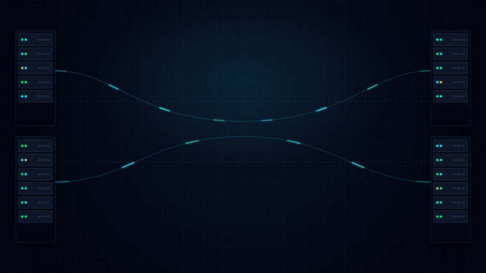

# NinjaOne Infra Dashboard & Unified Patch Toolkit ⚡

[](https://www.python.org/downloads/)
[](https://dash.plotly.com/)
[](https://opensource.org/licenses/MIT)
[](https://github.com/adchhabria/Ninjaone-Infra-Dashboard/releases)
[](tests/)

An enterprise-grade infrastructure intelligence and operational patch management toolkit designed for **NinjaOne RMM**. Built for MSPs, IT infrastructure leaders, and compliance auditors to monitor multi-tenant device health, SLA aging backlogs, OS compliance thresholds, and multi-cloud hosting environments in real time.

---

## 🎬 30-Second Infrastructure Intelligence Showcase

<div align="center">

<a href="./brag.mp4" title="Click to Watch Full HD Video with Audio (brag.mp4)">
  
</a>

<p>
  <b><a href="./brag.mp4">▶️ Click Here to Watch Full HD Video with Sound (`brag.mp4`)</a></b> &nbsp;•&nbsp; 
  <b><a href="./ninjaone-architecture-showcase.html">🌐 Interactive Architecture Showcase (`HTML`)</a></b>
</p>

</div>

---

## 📐 Architecture & Telemetry Pipeline


---

## ⚡ Key Advantages & Operational Capabilities

* **⏱️ Zero Setup & Instant Portability**: Available as a single standalone executable (`Ninjaone-Infra-Dashboard.exe`). No Python runtime, browser drivers, or environment setup required.
* **🌗 Dynamic Light & Dark Mode Toggle**: 1-click theme switching dynamically re-skins cards, charts, typography, modals, and data tables with high-contrast palette options (`#0F172A` in light mode), persisted in browser local storage.
* **🎛️ Ergonomic 2-Row Multi-Select Filter Bar**: Replaced single-line slicers with a structured 2-row multi-select dropdown interface (Organization, Location, OS Family, Device Roles, Patch Scope) featuring live badge counters and a 1-click **↺ Reset Filters** button.
* **✨ Animated OS Donut Expansion**: Smart CSS expansion (`.os-donut-col-expanded`) automatically hides empty operating system cards and smoothly scales Windows or Linux donuts to full width when filtered.
* **🛡️ Device Roles Intelligence**: Automated extraction of server roles (Domain Controller, Database Server, Web Server, File Server, Application Server, Backup Server, Workstation) enabling role-specific compliance tracking.
* **🔒 Precision OS Patch Compliance Governance**: Strictly evaluates OS-level **Cumulative Updates** and **Security Updates** against uninstalled approved patches while automatically excluding Microsoft Office, .NET, and SQL Server noise.
* **📋 Discovered Fleet Patch Title Direct Overrides**: Administrators can select specific discovered patch titles in Settings to strictly enforce non-compliance when missing on any machine.
* **⚡ Zero-Latency Performance Architecture**: In-memory slice caching delivers sub-millisecond (**0.02 ms**) filter responses; network circuit-breaking stops background retry freezes; and granular Dash callbacks update only target DOM nodes without re-mounting canvas elements.
* **📊 4 Specialized Operational Workspaces**:
  * **Executive Overview**: High-level fleet KPIs, interactive WebGL/SVG world map, OS distribution, hosting split, and compliance gauges.
  * **Patch Operations & SLA Aging**: Granular SLA aging backlogs (<30d, 31-60d, 61-90d, 90d+) and severity breakdowns.
  * **Reboots & Failure Watchlist**: Real-time tracking of pending reboot states and recurring patch failures.
  * **Reports & Excel Export**: Filter-aware downloads in Interactive HTML, multi-page vector PDF, and 6-sheet formatted Excel workbooks.
* **🔄 Built-In Auto-Updater**: In-app version checks, background downloads with progress feedback, and seamless zero-lock binary restarts.

---

## 📂 Project Structure

```
ninjaone-dashboard/
├── .github/
│   └── workflows/
│       └── build_release.yml          # GitHub Actions automated release pipeline
├── scripts/
│   ├── build_single_exe.py            # Standalone single .exe PyInstaller packager
│   ├── build_exe.py                   # Directory-based distribution packager
│   ├── generate_sample_data.py        # Mock dataset generator & sub-ms RAM slice cache
│   └── version_info.txt               # Windows PE executable version metadata
├── src/
│   ├── api/
│   │   ├── client.py                  # NinjaOne REST API client with OAuth2 PKCE
│   │   ├── models.py                  # Pydantic data models & device role classifier
│   │   └── patches.py                 # Patch catalog queries & approval models
│   ├── cache/
│   │   └── persistent_cache.py        # Local disk & memory TTL caching layer
│   ├── dashboard/
│   │   ├── assets/
│   │   │   └── custom.css             # Theme variables, badges & expansion animations
│   │   ├── components/
│   │   │   ├── compliance_table.py    # Non-compliant servers & patch inventory table
│   │   │   ├── eol_panel.py           # End-of-life OS breakdown charts
│   │   │   ├── kpi_cards.py           # Executive metric cards
│   │   │   ├── map_panel.py           # Interactive world map datacenter visualization
│   │   │   ├── org_slicer.py          # 2-row multi-select dropdown filter bar
│   │   │   ├── os_panel.py            # Windows & Linux OS donut charts (animated)
│   │   │   ├── patch_panel.py         # Patch status overview & compliance gauge
│   │   │   ├── reboot_failures_panel.py # Reboot status & failure watchlist
│   │   │   ├── reports_panel.py       # Report export controls & format selector
│   │   │   ├── server_panel.py        # Server hosting & infrastructure panels
│   │   │   ├── settings_modal.py      # Governance, thresholds & PKCE auth modal
│   │   │   └── sla_panel.py           # Patch aging & SLA compliance charts
│   │   ├── app.py                     # Dash application entry point & factory
│   │   ├── callbacks.py               # Granular event routing & fast tab switcher
│   │   ├── charts.py                  # Themed Plotly visualization builders
│   │   ├── layout.py                  # Root application layout & nav shell
│   │   └── theme.py                   # Dark & Light palette constants & helpers
│   ├── metrics/
│   │   ├── aggregator.py              # Multi-tenant metrics slice aggregator
│   │   ├── data_provider.py           # Coordinator & network circuit breaker
│   │   ├── excel_export.py            # OpenPyXL 6-sheet audit report generator
│   │   ├── patch_compliance.py        # OS-specific update compliance evaluator
│   │   └── pdf_export.py              # ReportLab multi-page vector PDF generator
│   ├── reporting/
│   │   └── html_export.py             # Self-contained interactive HTML exporter
│   └── utils/
│       └── updater.py                 # Semantic version checker & auto-updater
├── tests/
│   ├── test_charts.py                 # Visualization rendering tests
│   ├── test_client.py                 # API authentication & client tests
│   ├── test_download_callbacks.py     # Export endpoint tests
│   ├── test_excel_export.py           # Excel workbook integrity tests
│   ├── test_html_export.py            # Standalone HTML export tests
│   ├── test_metrics.py                # Aggregation & OS compliance rules tests
│   ├── test_patch_sla.py              # Patch aging backlog calculation tests
│   ├── test_patches_api.py            # Patch API & exclusion parsing tests
│   ├── test_pdf_export.py             # Vector PDF rendering tests
│   ├── test_pkce_auth.py              # PKCE authorization flow tests
│   ├── test_ui_enhancements.py        # Themes, multi-select, role & animation tests
│   └── test_updater.py                # Update checking & semver tests
├── config.yaml                        # Global SLA & compliance defaults
├── launcher.py                        # Desktop launcher with auto-browser opening
├── Ninjaone-Infra-Dashboard.exe       # Pre-compiled standalone Windows binary
├── requirements.txt                   # Production dependencies
└── version.json                       # Version manifest (v1.0.20)
```

---

## 🚀 Quick Start

### Option 1: Standalone Binary (Windows)
Download the latest `Ninjaone-Infra-Dashboard.exe` from [Releases](https://github.com/adchhabria/Ninjaone-Infra-Dashboard/releases) and double-click to launch. No dependencies or Python runtime needed.

### Option 2: Run from Source
```bash
git clone https://github.com/adchhabria/Ninjaone-Infra-Dashboard.git
cd Ninjaone-Infra-Dashboard
python -m venv venv && .\venv\Scripts\activate
pip install -r requirements.txt

# Run in Interactive Demo Mode (No API keys required)
python src/dashboard/app.py --demo
```
Access the dashboard at **[http://localhost:8050](http://localhost:8050)**.

---

## ⚙️ NinjaOne Connection

Configure your API credentials in **⚙️ Settings** within the web UI, or set environment variables in `.env`:

```ini
NINJA_BASE_URL=https://app.ninjarmm.com  # or https://eu.ninjarmm.com
NINJA_CLIENT_ID=your_client_id
NINJA_CLIENT_SECRET=your_client_secret
```
*Required API Scopes: `monitoring`, `management`, `control` (optional for remote reboot/rescan triggers).*

---

## 🛠️ Build & Test

```bash
# Run complete test suite (72 automated tests)
python -m pytest

# Compile single standalone Windows executable
python scripts/build_single_exe.py
```

---

## 📄 License

Distributed under the [MIT License](LICENSE).
